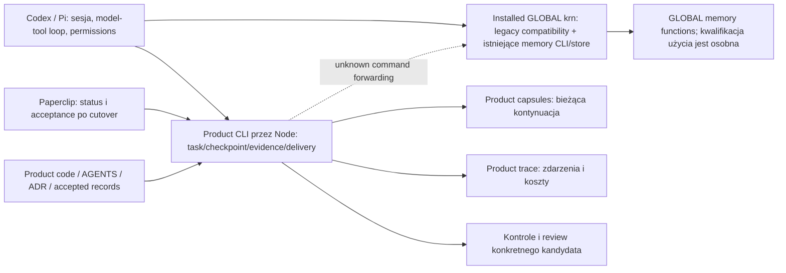
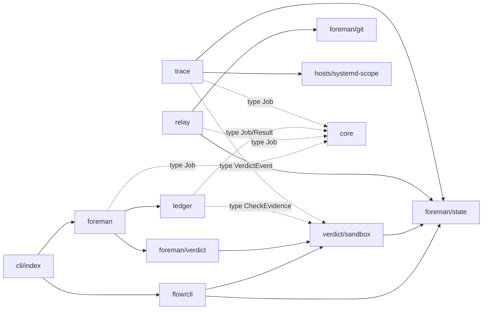
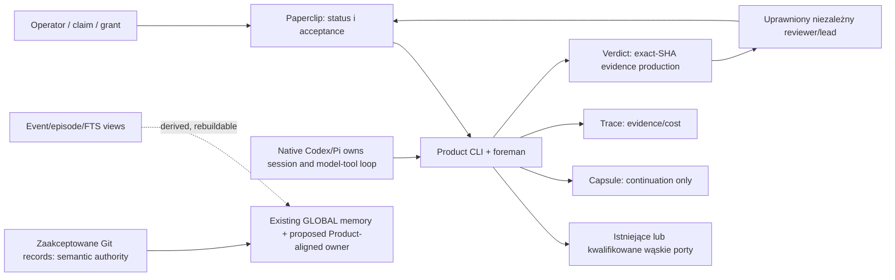

# Architektura KRN: aktualny układ i proponowane granice

**Stan źródeł:** Product `cf103a9ac74fa20be236d7c0e915b5d1026cabc0`; GLOBAL readback `0606e4145a2fd1937a6108c76089f219a4617546`. Ten dokument indeksuje aktualny graf i wspiera propozycję aktualizacji [kanonicznego planu produktu](https://github.com/krn-works/krn-codex-skills/blob/0606e4145a2fd1937a6108c76089f219a4617546/docs/research/product-architecture.md) oraz [roadmapy wykonawczej](https://github.com/krn-works/krn-codex-skills/blob/0606e4145a2fd1937a6108c76089f219a4617546/docs/research/self-hardening-roadmap.md). Nie ustanawia trzeciego właściciela roadmapy. Proponowane targety oznaczono `[HYPOTHESIS]`.

KRN ma łączyć repozytorium, obowiązujący task, kontekst/checkpoint, ograniczone wykonanie, dowód i dostarczenie w natywnym Codex/Pi. Host posiada rozmowę, model–tools loop, sesję i techniczne permissions. Product KRN nie tworzy drugiego agenta, providera, trackera ani panelu. Paperclip pozostaje właścicielem statusu/acceptance po cutover; kod, AGENTS i ADR pozostają prawdą repo; kapsuła służy bieżącej kontynuacji; trace jest zdarzeniami/dowodem; zaakceptowane Git records są semantycznym autorytetem.

## Rzeczywiste entrypointy i właściciele

[CODE] Zainstalowane `/home/krn/.local/bin/krn` wskazuje na GLOBAL `scripts/krn.mjs` w release `0606e414…`, a nie na Product `src/cli/main.ts`. Product CLI wywoływane przez Node ma `start`, `checkpoint`, `stop`, `note`, `review`, `delegate`, `report journey`; nieznane komendy przechodzą do skonfigurowanego legacy entry z recursion guard. GLOBAL CLI ma aktywne install/capability/repo/state/skills/lessons/changes/conformance/harness i memory surfaces, z realnymi callerami. Migracja wymaga inventory i parytetu; samo podobieństwo nazw nie jest kontraktem. Nie czytano effective host settings/profile/auth ani tego, co ładuje świeża sesja.

[CODE] Product `src/memory/` nie istnieje; **nie wynika z tego, że KRN nie ma pamięci**. Zainstalowany GLOBAL CLI i store wykonują istniejące funkcje pamięci, a readback oznaczył LON-128/130/131/132/133 oraz 127/139–142 jako `done`. Ich statusy nie są świeżymi dowodami użyteczności ani wszystkich runtime contracts. LON-129 paired recall ma `backlog`, LON-134 dispatch binding `blocked`, LON-135/136/137 `backlog`; osobny PRODUCT ADR 0002 proponuje v2 WoZ i nie jest bramką uniwersalnej v1 ścieżki.

## Product import graph

[CODE] Jeden prywatny pakiet zawiera moduły `core`, `relay`, `foreman`, `ledger`, `verdict`, `trace`, `hosts`, `flow`, `cli`. `core` zawiera `Job`, `Result` i parser granicy Paperclip. `foreman/state.ts` jest obecnym wspólnym workspace/state seam. `ledger/paperclip-cli.ts` importuje `hosts/systemd-scope.ts`; `flow/repository.ts` importuje `TEST_FILE_GLOB` z `scripts/test-suite.mjs`. Poniższy graf pokazuje zebrane importy; kropkowane krawędzie są type-only.

Pętla modułowego sprzężenia `foreman → ledger → verdict → foreman/state` zawiera type-only `ledger → verdict`. Ścieżka zależności runtime `foreman/wrapper → verdict/sandbox → foreman/state` nie jest dowodem cyklu ewaluacji ESM. `runJob` ma wstrzykiwane zależności przez interfejsy, ale nie oznacza to, że wszystkie cross-imports są usunięte. Obecny `test/import-boundary.test.ts` chroni core, nie pełny graf.

## Proponowane granice do kwalifikacji

[HYPOTHESIS] Product repo staje się jedynym właścicielem publicznych KRN contracts, runtime i własnych KRN-native procedures, z jedną identyfikacją wydania. GLOBAL repo tymczasowo utrzymuje kompatybilność/dystrybucję, bo istnieją callers. Po B1/B2 inventory i parity decyzja wybiera wąski compatibility distributor albo retirement; fizyczna relokacja repo nie jest założona. Nie przepisywać backendu, którego semantics i caller są działające.

Kierunki targetu: `core` zachowuje neutralne kontrakty; `foreman` wiąże task i wykonanie; Paperclip adapter zarządza statusami; `verdict` produkuje exact-SHA evidence, a uprawniony reviewer/lead podejmuje acceptance; `relay` wiąże kapsułę do bieżącej kontynuacji; `trace` zapisuje zdarzenia/usage; `hosts` odpowiada za procesy, nie za model loop. Wydzielić neutral workspace/state owner dopiero po udokumentowaniu co najmniej dwóch konsumentów wspólnej semantyki/kosztu. Każdy Product core import nadal wskazuje wyłącznie do własnych plików.

Nie deklarować aktywacji Pi/Claude ani nowego hosta: Codex jest obecnym hostem w zweryfikowanym workflow, inne hosty wymagają odrębnej kwalifikacji. Nie dodawać drugiego memory store, trackera, panelu, serwisu ani daemonu bez named miss/caller i ownera. Istniejąca GLOBAL SQLite/event implementation jest odrębna od propozycji nowej warstwy; nie wolno jej usuwać ani mnożyć na podstawie samego stanu Product `src/`.

**Kolejność użycia tego indeksu:** propozycja i etapowanie odwołują się do [dodatku statusu i dowodów](program/roadmap-2026-10-20.md); bieżący Paperclip/status i proof limits — [audit 2026-10-20](program/audit-2026-10-20.md). Kody etapów są lokalnymi identyfikatorami propozycji wejściowej; nie tworzą ani nie zmieniają etapów kanonicznych planów GLOBAL.
