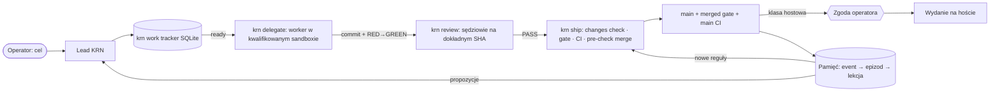

# Plan przełomu KRN — v2

**Owner:** lead (Claude Opus 5.5)  
**Status:** accepted direction by operator, 2026-10-21 (“masz zgodę, działaj”)  
**Zakres zastąpienia:** ten plan supersedes `roadmap-2026-10-20.md` for sequencing only. That roadmap remains a dated evidence crosswalk and architecture supplement.

Plan odpowiada na trzy pytania: jak KRN jest dziś zbudowany, gdzie traci czas i jakość, oraz w jakiej kolejności połączyć istniejące elementy. Opiera się na pięciu niezależnych mapach kodu i dokumentów oraz dostawie PR #418 i #419 z 2026-10-21. To kierunek programu i kolejność faz, nie samodzielne upoważnienie do taska ani zmiana polityk poza decyzjami odnotowanymi w charterze.

## Teza

KRN ma już większość potrzebnego silnika, ale nie korzysta z niego w jednym przepływie. Product ma `krn delegate`, `krn review` (red-first i niezależni sędziowie na dokładnym SHA), foremana z checkpointami i trace. GLOBAL ma `changes check`, gate, conformance, pamięć SQLite i uśpiony własny tracker `krn task`. Dostawa z 2026-10-21 przebiegała ręcznie: lead pisał briefy, uruchamiał `codex exec`, kopiował dowody i scalał zmiany. Przełomem jest spięcie istniejących części w jeden przepływ, który nie wymaga operatora jako pośrednika.

## Mapa bieżącego stanu

Dwa repozytoria, jeden host i jedna tablica zewnętrzna.

| Część | Gdzie | Stan | Uwagi |
|---|---|---|---|
| CLI-dusiciel i forwarding | Product `src/cli` | żywe | Mały, przetestowany kontrakt; zostaje. |
| `krn delegate`, `krn review` | Product `src/cli`, `src/flow` | zaimplementowane, niekwalifikowane | Pokrywają delegację, red-first i niezależnych sędziów; realne użycie niepotwierdzone, do sprawdzenia jedną prawdziwą dostawą. |
| Foreman / relay / trace / verdict | Product `src/` | żywe | Działają przez opt-in `KRN_LIVE=1`; realne użycie nieudokumentowane. |
| `changes check`, gate, conformance | GLOBAL `scripts/lib/contract` | żywe | Złapały błąd merge; rdzeń jakości. |
| Pamięć: event store, kursor, observe, wygasanie | GLOBAL `scripts/lib/memory` | żywe (fundament) | Brak automatycznego capture, epizodów i promocji. |
| Lessons pod nazwą `memory` | GLOBAL `scripts/lib/lessons` | żywe, przejściowe | Używane przez walidację i CI; dwa systemy pod jedną nazwą komendy. |
| Tracker `krn task` (~2600 linii) | GLOBAL `scripts/lib/task` | uśpiony | Własny tracker w stylu beads z claimami i lease'ami; claimy bez fencingu, store w Git-refach. |
| `krn ticket` | GLOBAL | wycofane | Publicznie martwe; helpery pozostały pod `task`. |
| Paperclip: ledger, preflight | Product `src/ledger`, `scripts/pr-preflight.mjs` | żywe | Do przeniesienia na własny tracker. |
| Paperclip: gateway, publisher, review-queue plugin | GLOBAL `scripts/lib/paperclip` | uśpione | Kod i testy bez wdrożenia; kandydat do wycięcia. |
| Blueprint v4, synthesis v3, audit 10-10 | Product `docs/program` | historyczne | Same oznaczają się jako historyczne; przenoszone do `docs/archive`. |
| 15 skilli źródłowych / 17 eksport / 40 na hoście | GLOBAL + host | rozrost | Katalogi runów wskazują użycie delivery-loop, delegate i slice-work; brak pełnych liczników. |

Product jest silnikiem pracy w TypeScript: CLI natywnie obsługuje `start / checkpoint / stop / delegate / review / report journey`, a pozostałe komendy forwarduje do GLOBAL. Foreman uruchamia sesje Codex, relay trzyma stan przez CAS i lease'y, trace zapisuje zdarzenia, a verdict uruchamia checki w sandboxie. Ledger i preflight są powiązane z Paperclipem.

GLOBAL jest właścicielem bramek, instalacji i pamięci w JavaScript. `krn` obejmuje około 15 rodzin komend: install/doctor, state, changes, gate, conformance, memory (lessons i event store), task (uśpiony), capability i harness. Repo ma 15 skilli, hooki PreToolUse/SessionStart i kontroler self-hosted CI. Host ma linki `~/.codex` do wydania 947746c (starszego niż main), hooki host-owned, 40 folderów skilli w `~/.agents/skills` i 172 wyłączone wpisy. CI działa przez rootless containerd: KRN ma 2 sloty, WP 1 slot, oba na nowym kontrolerze.

Obecny podział sterowania: Paperclip posiada zadania i akceptację; kapsuła `state.md` służy do wznowienia; ADR-y przechowują decyzje; statusy `krn/judge-*` i CI dowodzą stanu na SHA. Rola operatora obejmowała dotąd także pośrednictwo w dostawach.

## Tarcia potwierdzone dostawą

Wnioski wynikają z dostawy dwóch PR-ów, a nie z samej teorii.

| Tarcie | Co się stało | Koszt |
|---|---|---|
| Worker nie może uruchomić testów | Sandbox Codexa blokuje zagnieżdżony node, git i `.agents`; lead wykonywał RED/GREEN, commity i eksport. | Każda poprawka wymagała ręcznego cyklu leada. |
| Review w kawałkach | PR #418 miał 5 rund (58d049be → 1e090ecc → 2cbd1e18 → e85341d7 → 4ed91012), z kolejnymi coraz drobniejszymi uwagami. | 2 anulowane gate'y, 3 anulowane runy CI; czas oszacowany na kilka godzin. |
| Ręczny merge | PR #419 scalono bez trailera `Change-contract`; merged gate zakończył się kodem 1, a main CI 39634272051 nie powiódł się wyłącznie przez tę regułę na `2deba216`. | Incydent na main. |
| Rozproszone dowody | Logi, kody wyjścia, raporty i statusy były w kilkunastu plikach; recon nie połączył ich z PR. | Brak jednego zapisu dostawy. |
| Dwa silniki tego samego przepływu | Product ma delegate/review/foreman; praktyka używa skilli i ręcznego `codex exec`. | Podwójne utrzymanie, brak dojrzewania istniejącego silnika. |
| Trzy trackery w kodzie | Paperclip (żywy), `krn task` (uśpiony), Product ledger (do Paperclipa). | Niejasne źródło prawdy. |
| Wyciek sond CI | Stary checker zostawiał sondy; pula IP osiągnęła 243/253, a WP wpadał w pętlę awarii. | Naprawione przez #418 i wdrożenie. |

## Docelowy przepływ

Operator podaje cel na wejściu, rozstrzyga sprawy hostowe, bezpieczeństwa i nieodwracalne oraz przegląda to, czego system się nauczył. Pozostałą pracę prowadzi KRN pod twardymi bramkami:

Docelowo jeden tracker `krn work` ma być KRN-native i inspirowany beads: hash-ID odporne na kolizje między worktree, zależności, `ready` jako kolejka odblokowanej pracy, claim z fencingiem w SQLite i eksport JSONL do gita jako historia. Ma powstać po ograniczonej decyzji o ponownym użyciu istniejącego kodu `krn task` (schema/ABI, zależności, migracja, odtwarzanie). Paperclip pozostaje archiwum. Jeden generowany rekord na PR ma zawierać base/head, RED/GREEN, changes check, gate, sędziów, CI, merge SHA, main CI i instalację; pamięć pobiera z niego zdarzenia.

Lead akceptuje PR po wymaganych dowodach i zielonych bramkach na dokładnym SHA. Zgoda operatora pozostaje wymagana dla klas hostowych, bezpieczeństwa i nieodwracalnych; zmiana ADR 0007 jest warunkiem wejścia tej zasady w życie (ADR 0012).

## Fazy i warunki wyjścia

Fazy są uporządkowane według zależności. Każda kończy się dostarczonym i sprawdzonym kawałkiem; kolejna zaczyna się po uzyskaniu realnej ulgi z poprzedniej.

### F0 — Zamrożenie zakresu i higiena (w toku)

Zakres obejmuje tylko trzy strumienie: przepływ dostawy, jakość bramek i pamięć; pozostałe prace są wstrzymane. Zrobiono: worktree Product 13 → 1, GLOBAL 26 → 3; 17 zastąpionych branchy zachowano jako tagi `archive/*`. Pozostaje triage 6 otwartych PR (Product #8, #41, #43; GLOBAL #382, #396, #397), archiwum starych `.krn/tmp` oraz dokumentów historycznych.

**Warunek wyjścia:** wykonany triage wskazanych PR-ów, archiwum wskazanych plików tymczasowych i dokumentów historycznych oraz utrzymany ograniczony zakres trzech strumieni.

### F1a — `krn ship`, jedyna ścieżka merge (w toku)

Ścieżka odczytuje PR na dokładnym SHA i wymaga sędziów `krn/judge-*` oraz wszystkich zielonych checków. Następnie wykonuje lokalny merge z dokładną wiadomością, `changes check --before`, `gh pr merge --match-head-commit`, odczyt merge SHA i porównanie drzewa. Product dodatkowo uruchamia `pr-preflight` w tej samej ścieżce.

**Warunek wyjścia:** CLI ma falsyfikator dowodzący, że merge bez kontraktu jest niemożliwy; Product `pr-preflight` działa w tej samej ścieżce.

### F1b — Jeden generowany zapis dostawy na PR

Rekord obejmuje base/head, RED/GREEN, changes check, gate, sędziów, CI, merge SHA, merged gate, main CI i instalację. Reviewer ujmuje wszystkie uwagi w jednym przebiegu i ocenia ich materialność; FAIL występuje tylko dla uwag materialnych.

**Warunek wyjścia:** dla PR powstaje kompletny generowany zapis ze wskazanymi polami, a review przedstawia pełny zestaw uwag w jednym przebiegu.

### F2 — Kwalifikowany sandbox workera

Profil pozwala workerowi uruchamiać testy, commitować we własnym worktree i generować eksport, bez dostępu do sekretów i hosta. Kwalifikacja odbywa się na realnym przypadku przed użyciem, zgodnie z ADR 0007. Oczekiwany efekt: lead przestaje ręcznie wykonywać testy workera.

**Warunek wyjścia:** profil przechodzi kwalifikację na realnym przypadku zgodnie z ADR 0007 i udowadnia wymagane ograniczenia oraz możliwość wykonania pracy.

### F3 — Jeden silnik + P-052: ścieżka przez `krn delegate` i `krn review`

Jedna realna zmiana przechodzi przez silnik Product przy obecnym trackerze; luki naprawia się w silniku. Na tej podstawie rozstrzyga się P-052: które repozytorium (Product czy GLOBAL) jest właścicielem runtime'u, zanim powstanie tracker.

**Warunek wyjścia:** jedna realna dostawa przechodzi przez oba polecenia przy obecnym trackerze, a decyzja o właścicielu runtime'u zostaje podjęta przed implementacją trackera.

### F4 — Pilot `krn work` bez przełączenia

Najpierw zapada decyzja o reuse: które elementy `krn task` (ABI, zależności, migracja, odtwarzanie) są przenoszone, a które zastępuje SQLite. ADR 0011 dotyczy trackera, ADR 0012 akceptacji. Pilot poleceń `create / ready / claim / show / export` odbywa się w repozytorium wskazanym przez F3; zawiera jeden falsyfikator przez CLI.

**Warunek wyjścia:** zakończone rozstrzygnięcie reuse i działający pilot wszystkich wskazanych poleceń w wybranym repozytorium z jednym falsyfikatorem przez CLI.

### F5 — Wyjście z Paperclipa

Warunki przejścia to parytet akceptacji, odtwarzalna historia, procedura rollbacku oraz odczyt wszystkich aktywnych konsumentów (Product ledger i preflight, hook kapsuły, skille). Przełączenie następuje jeden projekt naraz; Paperclip zostaje jako archiwum tylko do odczytu.

**Warunek wyjścia:** wykazany parytet, odtwarzanie historii i rollback; wszyscy aktywni konsumenci są odczytani, a jeden projekt został przełączony z Paperclip zachowanym tylko do odczytu.

### F6 — Pętla pamięci

Startem jest jawny capture zweryfikowanych pól z rekordu dostawy, według listy dozwolonych pól, wyłącznie jako dowodu bez autorytetu. Epizody, zatwierdzanie lekcji oraz zamiana lekcji w regułę/check są osobnymi, przeglądanymi krokami. Pomiar obejmuje rundy review i incydenty na dostawę. Zgodnie z decyzją operatora idea zawsze działającego agenta F6 jest jawnie porzucona; opisana tu pętla nie ustanawia takiego agenta.

**Warunek wyjścia:** jawny capture zgodnych pól działa jako dowód, każdy kolejny krok pamięci przechodzi oddzielny przegląd, a pomiar obejmuje rundy review i incydenty na dostawę.

## Dostawa z 2026-10-21 i decyzje

PR #418: czyszczenie sondy po dokładnej nazwie i bezpieczna diagnostyka stage/class; merge `1a9a1d18`, gate 1638/0, main CI zielone. PR #419: wygasanie eventów pamięci po 90 dniach (ADR 0009), merge `2deba216`. Po zgodzie operatora usunięto 250 zatrzymanych kontenerów WP/demo, dzierżawy spadły z 243 do 3; nowy kontroler hosta obsługuje KRN (runnery 430/431) i WP (runner 31), a WP odzyskano po pętli awarii.

Obowiązujące kierunki decyzji: jeden lead Opus i wielu wykonawców/sędziów Codex; wyjście z Paperclipa do własnego trackera w stylu beads (pilot F4, przełączenie F5); akceptacja PR przez leada po dowodach ADR 0007, po wejściu ADR 0012 w życie; incydent `2deba216` zachowany bez przepisywania historii; porzucona idea zawsze działającego agenta F6. F0 ogranicza rozproszenie, a F1a ustanawia twarde bramki.

## Wskazówki do dowodów

Plan v2 i jego pierwotne mapy to working evidence, nie źródła bieżącego statusu ani dodatkowa zgoda. Ignorowany rekord runu leada: `../../.krn/runs/claude-lead-20261021/f0docs/plan-v2.html`. Zapis operatora jest w LON-319; trwałe decyzje są w [charterze](charter.md), propozycje w [rejestrze](proposals.md). Dated crosswalk z 2026-10-20 pozostaje w [roadmapie](roadmap-2026-10-20.md).
