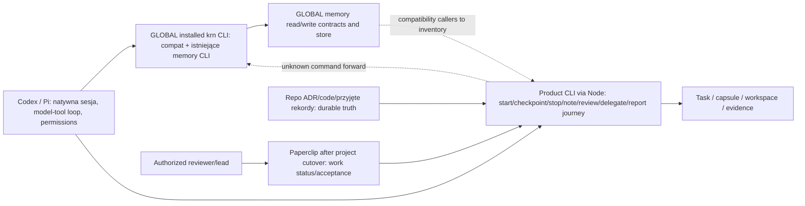
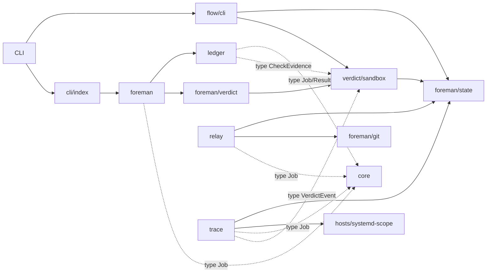
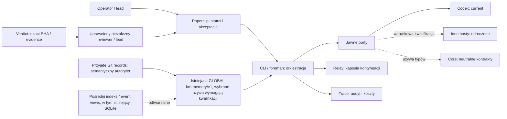

# Uzupełnienie stanu, architektury i dowodów KRN

**Stan na 2026-10-20; dodatek do kanonicznych planów.** Ten dokument jest datowaną migawką dowodów, grafem istniejących granic oraz propozycją zmian dla właścicieli [GLOBAL planu produktu](https://github.com/krn-works/krn-codex-skills/blob/0606e4145a2fd1937a6108c76089f219a4617546/docs/research/product-architecture.md) i [GLOBAL roadmapy dostarczania](https://github.com/krn-works/krn-codex-skills/blob/0606e4145a2fd1937a6108c76089f219a4617546/docs/research/self-hardening-roadmap.md). Nie jest trzecim, konkurencyjnym planem produktu ani kolejką etapów. Kody A0/A1/A2, B1/B2, M1–M5, R1/R2, Q1, T0/T1 są lokalnymi identyfikatorami dostarczonej propozycji aktualizacji; dalszy status należy czytać w Paperclip. Źródłem propozycji z tej rundy są materiały `native-harness-plan-20261020` i `native-harness-handoff-20261020` oraz odczyt Paperclip z 2026-10-20 15:38 UTC. Zarchiwizowana wcześniejsza wersja tego dodatku i raportu pozostaje w ignorowanym katalogu audytu do jawnej retencji.

[HYPOTHESIS] Docelowo KRN jest warstwą zobowiązań projektu, kontekstu, ograniczonego wykonania, dowodu, dostarczenia i odzyskiwania dla natywnego Codex/Pi. Host posiada rozmowę, model–tools loop, sesję i techniczne uprawnienia; KRN nie jest drugim silnikiem agenta, providerem, trackerem ani panelem. Propozycja to jeden właściciel Product dla publicznych kontraktów, runtime i własnych procedur, przy przejściowym GLOBAL compatibility/distribution ownerze do czasu wykazania parytetu callerów. Zachować istniejący backend i semantykę mające aktywnych callerów; migrować expand/contract, nie przepisywać bez powodu.

[EMPIRICAL] E1 pozostaje walidacją operacyjną bez wykazanego formalnego wyjścia. Przyjęte D1 ustala accepted outcomes bez escaped defects jako główną metrykę, raportowaną z interwencjami leada, promptami rekonstrukcyjnymi i tokenami. Po sześciu podróżach ramienia B rdzeń zamraża się, jeśli mediana interwencji leada na zaakceptowany wynik nie spadła o co najmniej 30% względem B0 albo wystąpił choć jeden P0/P1 escaped defect. Ponieważ B0=0 interwencji, pierwsza klauzula jest `not-evaluable`, bez PASS/FAIL; rozstrzyga druga. Minuty operatora są metryką pomocniczą. Historyczny E1 wymagał ≥3 zaakceptowanych wyników, ≥30% mniej mediany minut wobec baseline oraz braku utraconych zobowiązań/nieautoryzowanych efektów. Baseline minut równy zero uniemożliwia obliczenie progu czasu, ale nie usuwa po cichu warunków liczby wyników i bezpieczeństwa; właściciel ma pogodzić je z D1 przed formalnym E1 exit. E2 ma wiele ukończonych implementacji, lecz nie wykazano jeszcze pełnych warunków hardening exit. E3 pozostaje warunkowy; E4 oznacza końcowe wycofanie legacy zgodności/runtime po parytecie. Nie wyliczać postępu z liczby zadań.

## Stan produktu: działające kontrakty i ukryte granice

[CODE] Product jest pojedynczym pakietem TypeScript z modułami `core`, `relay`, `foreman`, `ledger`, `verdict`, `trace`, `hosts`, `flow`, `cli`; Product `src/memory` nie istnieje. Nie oznacza to braku pamięci w KRN: zainstalowany GLOBAL `krn` z release `0606e414…` ma istniejące komendy i magazyn pamięci. `core` zawiera dziś `Job`, `Result` i parser granicy Paperclip. Faktycznie współdzielony stan/repo paths leży w `foreman/state.ts`; `flow/repository.ts` importuje też `TEST_FILE_GLOB` z `scripts/test-suite.mjs`, a `ledger/paperclip-cli.ts` importuje hostowy `systemd-scope`. Graf modułów ma pętlę sprzężenia `foreman → ledger → verdict → foreman/state`, ale krawędź `ledger → verdict` jest wyłącznie typowa. Rzeczywista ścieżka zależności runtime to `foreman`/wrapper → `verdict/sandbox` → `foreman/state`; nie dowodzi cyklu ewaluacji modułów ES. `runJob` przyjmuje zależności przez interfejsy, lecz nie jest to pełne odsprzęglenie.

[EMPIRICAL] `/home/krn/.local/bin/krn` rozwiązuje się do GLOBAL `scripts/krn.mjs`; Product CLI jest wywoływane przez Node. Host natywny wykonuje model-tool loop i zarządza sesją/uprawnieniami, a Product CLI wiąże task, checkout, checkpoint, dowód i delivery. Legacy `krn memory` ma realnych callerów; Product brak dispatcherów nie pozwala pominąć migracji tych callerów/store/release.

[HYPOTHESIS] Cel architektoniczny to jeden pakiet i jawne porty: `core` dla stabilnych, adapter-neutralnych typów; moduł neutralny workspace/state tylko gdy kilku właścicieli potrzebuje tej samej semantyki; `foreman` jako orkiestrator; `ledger` jako Paperclip adapter; `verdict` jako producent exact-SHA evidence; `hosts` jako wykonawcy procesów; `relay` jako task continuation; `trace` jako evidence/cost ledger; warunkowy przyszły semantic recall poza obecną listą modułów. Decyzja acceptance pozostaje u uprawnionego reviewera/leada i w Paperclip. Zachować regułę `core` importuje wyłącznie własne pliki i dopiero osobny runtime kontrakt uzasadnia nowy falsifier.

Fizyczna relokacja repo i unifikacja release są propozycją, nie faktem ani warunkiem pierwszego tasku A2. Do czasu inventory i parytetu GLOBAL repo utrzymuje kompatybilność; po migracji pozostaje decyzja: wąski distributor albo wycofanie. Host settings, installed pointers i effective load nie zostały odczytane.

[CODE] Graf pokazuje krawędzie modułów, nie pełną semantykę runtime ani dynamiczne ładowanie. Import typów nie jest zależnością runtime. Pętla sprzężenia obejmuje krawędź type-only; ścieżka runtime `foreman → verdict/sandbox → foreman/state` opisuje zależność, nie potwierdzony cykl ewaluacji ESM. Obecny test granicy sprawdza wyłącznie core.

[HYPOTHESIS] Docelowy graf kieruje zależności implementacyjne przez jawne porty i utrzymuje oddzielne autorytety. Paperclip pozostaje źródłem statusu/akceptacji; kapsuła jest wyłącznie kontynuacją bieżącego zadania; trace jest dowodem zdarzeń i pomiarów; przyjęte rekordy Git są semantycznym źródłem wiedzy. Indeks/event-store są pochodne, nie autorytet. GLOBAL memory ma istniejący CLI/store i typed-event/SQLite insert foundation; nie budować drugiego store ani zakładać, że wszystkie historyczne M1–M5 są do zaimplementowania. Nowy storage/host/tracker/service wymaga nazwanego missu i konsumenta.

| Zdolność | Stan na odczyt 2026-10-20 | Granica dowodu |
|---|---|---|
| CLI strangler | [CODE] Obsługuje wybrane komendy; nieznane forwarduje do `KRN_LEGACY_ENTRY` (domyślnie `~/.codex/krn/current/scripts/krn.mjs`) z ochroną rekurencji. | Nie oznacza pełnego cutover ani uprawnienia hostowego. |
| Komendy produktu | [CODE] `node src/cli/main.ts start`, `checkpoint`, `stop`, `note`, `review`, `delegate`, `report journey`; live jest opt-in. | Nie dopisywać nieistniejącego `run` jako aktualnej komendy. |
| Orkiestracja/proof | [EMPIRICAL] LON-282 przyjęte po lokalnej kompozycji `runJob`, CodexHost, checkpoint, systemd scope i evaluatorze; worker syntetyczny, bez sieci. | Nie dowodzi prawdziwego providera, live Paperclip ani ogólnego crash recovery. |
| Interrupt/resume | [EMPIRICAL] LON-209 SIGTERM drain `todo`; nie ma tu świeżego przerwania i wznowienia w nowym procesie. | Wymaga fizycznego odczytu PID/scope i związania HEAD/checkpointu. |
| Natywne skills | [EMPIRICAL] Projektowy export 17 skills został zatwierdzony jako ograniczony efekt, fresh Codex 0.163 `skills/list` odnalazł 17 enabled/errors 0, lecz ZERO model turns. Operator potem odrzucił architekturę; 54 pliki/hashy sprawdzono i export odwracalnie przeniesiono do `withdrawn-matt-baseline-project-export`; `.agents/skills` produktu jest nieobecny. | To rzeczywiste discovery baseline’u odrzuconego, nie użycie ani walidacja własnej procedury KRN. Nie odtwarzać/reinstalować tego pakietu. Nowy KRN-owned current route pozostaje niekwalifikowany. |
| Lessons | [EMPIRICAL] Aktualny state audit wskazał `workflow-lessons/malformed-lesson` dla `Status: active`; istniejące poprawione bajty LON-309 wymagają właściwego checka. | Poprzedni check referował dokument jako check i dał `unknown-check`. |
| Pamięć | [CODE]/[EMPIRICAL] GLOBAL installed CLI/store istnieje. Readback: LON-128/130/131/132/133 `done`, LON-127/139–142 `done`; LON-129 `backlog`, LON-134 `blocked`, LON-135/136/137 `backlog`, LON-185 `in_progress`. | Status issue nie jest behavior proof. LON-133 dotyczy istniejącego digest/bundle; jego bieżącego przypisanego właściciela nie odczytano. PRODUCT v2 WoZ jest oddzielnym, nieprzyjętym gate; nie blokuje całego v1.

[EMPIRICAL] LON-308 był runtime test-approval fix. PR #74 na `cf103a9…` i CI 817/817 to historyczny dowód dla LON-308, nie bieżący gate. Osobny root gate tej rundy również przeszedł na zapisanym candidate manifest; dowód i granice są niżej. LON-282 pozostaje ograniczonym przyjętym proofem; dodatkowy Opus report był waived, nie wykonany. LON-309 ma zachowane poprawione bajty `1cf0dcc…`; root state check potwierdził format/state lokalnie, ale issue nadal `todo`, kanoniczne `unknown-check` pozostaje niezaliczone. Najnowszy Paperclip readback: LON-310 `todo`, LON-209 `todo`; readback memory statuses podano w tabeli.

## Proponowany graf etapów i granice tego dodatku

[CODE] Kanonicznym właścicielem produktu pozostaje GLOBAL `product-architecture.md`, a wykonawczego DAG-u — istniejący GLOBAL `self-hardening-roadmap.md`. Poniższe kody A0/A1/A2, B1/B2, M1–M5, R1/R2, Q1, T0/T1 pochodzą z dostarczonej propozycji dla tych ownerów. Nie używamy już własnej kolejki R0–R14. Tabela służy jako crosswalk i uzupełnienie statusu; nie tworzy nowych issue ani nie zmienia zależności w Paperclip.

Historyczne E1 `S1–S8` pozostaje odrębne od późniejszych nazw runtime: S1 abort=LON-287/PR #62; S2 metadata=LON-290/PR #64; S3a trace=LON-291/PR #65 plus LON-294/PR #66; S3b trace=LON-292/PR #67. Odczyt potwierdził te cztery późniejsze karty jako complete. Nie przenosić ich stanu na E1 ani używać własnych stage labels do zastąpienia E1/E2 exit. E2 exit z blueprinta wymaga 10 journey/regression cases; kompletny dowód tu nie stwierdzono. E4 jest przyszłym wycofaniem ostatnich legacy callerów po parytecie.

| Etap i widoczny wynik | Właściciel, zakres i zależności | Źródło → mechanizm → lokalne rozstrzygnięcie | Rzeczywisty dowód / decydujący sprawdzian | Wycofanie i rollback |
|---|---|---|---|---|
| **A0 —** następna sesja zna legalny task, claim, grant, branch/head i nierozstrzygnięte punkty. | Root/delivery-loop i bieżący Paperclip assignee; używać istniejącej kapsuły/ExecPlan/CONTEXT. Pierwszy obowiązkowy krok świeżego przebiegu. | ADR 0007 i `docs/program/charter.md` → aktualny control plane ustala status/authority → odświeżyć LON-310/status, nie ufać dawnemu planowi. | Root fresh-readback: LON-310=`todo`; dalszy dispatch wymaga ponownego odczytu tasku/grantu. Ten raport nie przypisuje pracownikowi z `null` assignee. | Brak efektu poza aktualizacją należącej kapsuły; zakończyć/odświeżyć ją u jej właściciela. |
| **A1 —** krótki, normatywny Product AGENTS i jedna minimalna własna procedura delivery-loop są natywnie dostępne, poprawnie wyzwalane i mają warunki zatrzymania i wynik. | Product maintainer, standards owner i jeden integrator. Zmieniać `spec/rules.json`/renderer, nie wygenerowany AGENTS; szczegóły tylko w istniejącym ownerze albo po stwierdzonym potrzebnym native package. Zależy od A0, nie od LON-209, pamięci ani migracji CLI. | KRN-05–08 oraz istniejące globalne źródła procedur i ocen → przenieść tylko konkretnego ownera i procedurę → projektować KRN-native delivery-loop bez kopiowania treści Matt/legacy; nie tworzyć ogólnego routera. | Obserwowany baseline projektu: odkrycie pakietu pochodzącego od Matt `17 enabled / 0 errors`, ale 0 model turns i operator później odrzucił tę architekturę. Własnego current skill route nie ma; przyszły falsifier to fresh explicit/implicit/negative route z prawdziwym task input/output, ownerem i wymaganym proofem. | Jeśli trigger/wyjście/owner nie działa, poprawić lub zrezygnować z skill i użyć obecnego Product CLI. Stare prozy nie usuwać przed transferem; rollback przez source-level commit. |
| **A2 —** jeden zwykły, uprawniony task KRN przechodzi natywnym Codex/Pi i istniejącym Product CLI od tasku przez checkpoint i dowód do odczytu statusu i przeglądu. | Root/delivery-loop i faktyczny task owner; istniejące `src/cli`, foreman, relay capsule, repo checks/reviewer. Zależy tylko od A0/A1; nie wymaga B2, memory completion, unattended, S5, LON-209 ani CLI migration. | Product CLI już wiąże task/checkpoint; host sam wykonuje model-tool loop → rzeczywisty natywny task sprawdza wartość minimalnej procedury → wykonać jeden current task bez pretense o pełnej kwalifikacji. | LON-282/308 są już ograniczone, zakończone dowody; nie powtarzać. A2 jeszcze nie wykonano. Falsifier: błędny route, nieistniejąca komenda/flag, utracony wymóg, authority drift, check/review fail albo nieczytelny wynik. | Porażkę zachować i wrócić do A1 lub właściciela. Nie zamykać Paperclip ani nie nazywać całego produktu kwalifikowanym. |
| **B1 —** operator widzi każdy rzeczywisty CLI command, alias, skill/hook/script/project caller, store/schema i release owner. | Product CLI maintainer + GLOBAL installer/release maintainer; odczyt źródła w obu checkoutach i installed help, bez host apply. Zależy od A0; może biec równolegle do A1/A2 i memory/R1. | Strangler i istniejący legacy `krn` są aktywnymi interfejsami → inventory argumentów, wartości domyślnych, strumieni, kodu wyjścia, efektów, callerów, schematów i wskaźników → nie dedukować API z skill prose ani nazw komend. | Raport inventory nie został ukończony w tej rundzie; `native-harness-plan` definiuje pola. Rozstrzygający check: żaden caller/release/schema/path/side effect nie pozostaje nieznany dla family wybranej do migracji. | Inventory jest read-only; wycofa row po świeżym source/caller readback. Brak powodów do kasowania callerów. |
| **B2 —** po jednej rodzinie komend Product ma jawny publiczny kontrakt i zgodność callerów przy zachowanym rollbacku. | Jeden Product CLI owner + GLOBAL compatibility/distribution owner. Zakres: tylko family z B1 i jeden caller slice; zależy od jej live task/spec, nie jest A2 prerequisite. | Expand/contract migration → fixture porównuje argv/stdin/out/err/exit, JSON schema, errors, effects, source/schema/release compatibility → zachować forwarding/recursion guard do ostatniego caller proof. | Brak nowej migracji w tej dokumentacji. Falsifier dla faktycznie zmienionego runtime contract: public assertion RED na base, GREEN na candidate; existing gate/review. | Przy regresji przywrócić poprzedni dispatch/sealed release; wycofać wyłącznie starego ownera po wszystkich callerów readback/parity/rollback. |
| **M1 —** sparowanej użyteczności pamięci w rzeczywistych zadaniach odpowiada, czy istniejąca pamięć poprawia wynik po pełnym koszcie. | Właściciel LON-129 (assignee w aktualnym readbacku `null`, więc osoba nieznana) i evaluator/operator. Zależność od przyjętego task set i kwalifikowanego caller/source; może biec równolegle z A1/A2/R1. | GLOBAL ADR 0008/0009 + ADR 0006 cost history → sparować real taski i porównać rzeczywiste wyniki i koszty → nie utożsamiać implemented backend/status `done` z użyteczności. | LON-129=`backlog`; test nie wykonano. Kryterium i dobrane zadania i ich odczyt ustalić przed runem; lokalna WoZ B/C/R to oddzielny eksperyment. | Brak gainu/inconclusive: ograniczyć/wycofać implicit recall, zachować inne potrzebne backend callers; brak danych nie uzasadnia cleanup. |
| **M2 —** typed event/episode sources są czytelne, odtwarzalne i refusal/unavailable są jawne. | Ownerzy istniejących LON-143/144, adapterów 145/146/148/149/150/151/152 i validator/observer 157–160; każdy z własnym fixture/source scope. Zależą od ukończonej 140–142 foundation, ale nie od A2. | ADR 0009 provenance layers → fixture-first, cursor/replay, dokładnego źródła i rewizji, idempotency → nie włączać szerokiego capture z powodu statusu issue. | 140–142 mają status `done`; następne karty mieszały się z backlog. Check per changed behavior: crash przed cursor advance bez duplicate; malformed/foreign refuse; unavailable/partial/stale jawnie odróżnione. Nie wykonano tu. | Odstawić adapter który nie ma legalnego źródła/callera; zachować source receipts i rollback do read-only/bez zapisu. |
| **M3 —** operator widzi source i wszystkie derivations przed retention/forget/purge/restore; deletion epoch blokuje resurrection. | Ownerzy LON-153–156 + operator dla rzeczywistego purge. Kwalifikować preview/fixture przed broad capture/activation. | Privacy/retention contracts → najpierw preview wszystkich source/index/bundle/derivations, potem preview, authorized purge, suppression i restore proof → nie zakładać istniejącej done status. | Bieżący snapshot LON-153–156 wskazuje `backlog`; testów nie wykonano. Falsifier: po restore żaden usunięty rekord nie wraca, retry idempotent. | Błąd lub niepełna lista: zatrzymać capture/purge; przywracać wyłącznie przez ownera i zgodnie z epoch/retention. |
| **M4 —** scoped lexical records/events/receipts/proposals mają pochodne indeksy i zweryfikowaną source lineage. | Ownerzy LON-161–170; LON-131 governed proposal checks istnieje jako `done`; konkretne callers i statusy odświeżyć. Zależy od odpowiednich typed record foundations i uprawnień i zakresu, nie wszystkie karty czekają jedna na drugą. | ADR 0008/0009 + istniejąca governed proposal API → FTS jest zwykłym pochodnym lexical index; proposal nigdy nie promuje się sam → nie dodawać vector bez osobnej podstawy. | Istniejące work items są mieszanką done/backlog; bieżący snapshot LON-161–170 wskazuje `backlog`. Decydujący check: stale/empty/conflict/foreign odróżnione; źródło/digest/scope odtwarzalne; proposal przechodzi tylko istniejący review. Nie wykonano tutaj. | Odłączyć consumer/indeks po utracie ownera; zachować Git semantic authority i źródłowe records. |
| **M5 —** tylko nazwane temporal/consolidation/context consumers powstają po sprawdzeniu callerów i privacy. | Ownerzy LON-171/173/174/175 oraz kwalifikacyjnych memory ticketów; potwierdzić aktualny parent/dependency graph. Zależy od własnych typed/source prerequisites; nie jest A2 prerequisite. | Layered-memory ADR → oddzielić capture, derivation, accepted record, context packet i task capsule → nie budować drugiego store, nie uznawać LON-143–177 za jeden pojedynczy szeregowy zakres funkcji. | Readback wskazuje LON-133 digest/bundle `done`, LON-134 dispatch `blocked`, LON-135/136/137 backlog; LON-185 in progress, ale jego zachowanie nie jest tu zweryfikowane. Poszczególne M2–M5 checki pozostają przyszłe per issue. | Brak nazwanego konsumenta lub privacy gate: defer/retire dany consumer, nie reimplementuj ukończonych 128/130/131/132/133/127/139–142. |
| **R1 —** LON-209 controlled SIGTERM drain pokazuje, czy owned scope/children wyczyszczono pod nazwanym warunkiem. | Owner issue w Paperclip jest nieznany (assignee `null`); operator/proof lead. Biegnie niezależnie od A1/A2 i LON-129. | Otwarte LON-209 + systemd scope → świeży dowód zatrzymania pod obciążeniem na bazie i kandydacie → ograniczona zmiana runtime wyłącznie gdy baza falsyfikuje. | LON-209=`todo`; test nie wykonano tu. Odczytać PID/scope/child tree aż do zera i final effects. LON-306 to interrupted-free session, nie substytut. | Revert ograniczoną ścieżkę lub próbę zatrzymania po escaped child; zachować previous stop behavior/failure receipt; zamknąć dopiero po owner acceptance. |
| **R2 —** świeża sesja po prawdziwym przerwaniu kontynuuje aktualną zgodę/checkpoint/head i przedstawia pełny koszt. | Journey/runtime owner i niezależni reviewerzy; update `src/evals/journey*`, tylko gdy wybrana karta wskazuje. Zależy od własnego stop/checkpoint prerequisites; nie czeka na M1–M5 ani całą CLI migration. | LON-306 nieprzerwane 38.3 s + capsule/CAS source → osobny process/session interrupted-resume evaluator → status/ABI nie dowodzi real recovery. | Nie wykonano. Falsifier: session1 checkpoint/stop; process dead; fresh session reads current task and resumes correct branch/head/checkpoint; reviewer/evaluator checks authority and result; record full retries/cost. | Niepowodzenie: przerwać próbę, zachować dotychczasową ręczną kontynuację i zapis niepowodzenia; pojedynczy przebieg nie uzasadnia szerokiej aktywacji pamięci. |
| **Q1 —** operator podejmuje bounded promotion/defer decision z held-out outcomes i pełnym kosztem właściwej warstwy. | Operator + evaluator + niezależny recenzent; nieznane ID/assignee do świeżego Paperclip readbacku. Zależy wyłącznie od warstw, które mają być szeroko promowane; nie warunek pojedynczego nadzorowanego A2. | GLOBAL ADR 0006 cost evidence jest małą/nasyconą i ograniczoną próbką; vendor papers/cookbooks to mechanizmy, nie uplift KRN → matched tasks/authority/reviewer/telemetry, preregistered layer and stop bounds. | Brak nowego porównywalnego baseline’u dla tego kierunku; held-out evaluation nie wykonano. Nie wymyślać sample size, savings ani progu. | Wynik nierozstrzygający albo brak użyteczności: odłożyć lub pozostawić opcjonalne; zachować tylko zdolności o niezależnie wykazanej wartości. Cofnąć promowaną warstwę przy regresji wyniku/uprawnień lub nieuzasadnionym koszcie. |
| **T0 —** zbędna globalna proza/override nie wczytuje się już tam, gdzie właściwy owner przejął obowiązek; non-KRN repo nadal działa bez wymuszonego procesu KRN. | Operator/host owner + GLOBAL maintainer/reconciler; tylko po A1/A2, current host-owner readback, dokładnym scope i osobnym host grancie. Nie czeka na pełną memory/recovery/CLI parity. | Pięć typów nadpisań i transfer obowiązków → kopia z właściwymi uprawnieniami, hash, zapieczętowane wydanie, odczyt symlinka i świeżej sesji, zgodność procedury SessionStart tam, gdzie jest używana, próba w projekcie KRN i niezależnym repo oraz sprawdzony rollback → wycofywać wyłącznie tę regułę, której właściciel i działanie zostały potwierdzone; stary tekst oceniać punkt po punkcie. | Nie ma dowodu odczytu hosta/profilu/efektywnego ładowania ani grantu na te działania. Własny wynik świeżej sesji nie został zebrany. Hooki pozostają wyłączone; nie reinstalować ani nie aktywować ich w ramach migracji. | Przed zmianą zachować permission-correct backup/hash; installer refusal ma pozostać jawny; wycofanie tylko operator/reconciler zgodnie z typem. Przy mismatch przywrócić poprzedni release/file i readback; cleanup/deletion wymaga odrębnego scope. |
| **T1 —** jeden kanoniczny Product release/API lub jawny, ograniczony compatibility distributor; brak starych-only callerów. | Product maintainer + GLOBAL installer owner + operator/maintainer decyzji. Zależy od B1/B2 caller, store/schema, install/rollback parity i accepted source/release direction; nie jest bieżącym krokiem. | ADR 0006 pozwala reopen po zmianie operatora; installed GLOBAL release ma aktywnych callerów → expand/contract, jeden właściciel, publiczny kontrakt i tożsamość wydania przy zachowanym rollbacku → fizycznie scalić repo dopiero po udowodnionej wartości. | Inventory, parytetu wydania, pełnego parytetu instalacji i migracji nie wykonano. Gate sam tego nie dowodzi. | Retire starego entrypoint/source dopiero po potwierdzeniu braku callerów używających wyłącznie starego interfejsu, teście odtworzenia, decyzji o retencji i jawnej akceptacji. W razie mismatch powrót do zapieczętowanego poprzedniego wydania; żadnego hard delete z tego planu. |

**Zależności i kolejność:** A0 → A1 → A2 to pierwszy pion. B1/B2, M1 i R1 mogą biec równolegle po A0 w oddzielnych scope; R2 jest osobny recovery lane; M2/M3/M4/M5 podlegają swoim ticket prerequisites, nie są sztuczną bramką A2. Q1 dotyczy tylko warstw promowanych; nie wymaga niewybranych M2–M5 dla każdego pojedynczego skill/task slice. T0 może nastąpić po A1/A2 i własnej host qualification; nie czeka na pamięć. T1 czeka na realny CLI/store/caller parity i rollback. Nie dodawać własnych nazw etapów do kanonicznego DAG-u. Nie przywracać daemona/recurring Paperclip; ADR 0007 utrzymuje execution dormant, LON-134 `blocked`, LON-172 ma historyczny backlog, wszystkie aktualne stany wymagają fresh readbacku.

**Protokół PRODUCT v2 WoZ pozostaje osobny.** `docs/adr/0002-brain-v2.md` nadal zawiera proponowane B−A, A–R, B−C i cost gates; frozen `evals/woz/prereg.md` zawiera inne warunki. Nie zmieniać zamrożonych progów ani dopasowywać ich po fakcie. Rozstrzygnąć jawnie przed WoZ runem. Nie narzucać go całemu przyjętemu GLOBAL v1 memory path ani uzależniać LON-129 od ukończenia wszystkich v2 warstw. LON-129 dotyczy sparowanej oceny użyteczności pamięci; nie łączyć go z PRODUCT B/C/R WoZ.

## Przekazanie obowiązków z instrukcji globalnych i override

[EMPIRICAL] Dozwolony tekstowy readback `/home/krn/.codex/AGENTS.override.md` i `/home/krn/.codex/AGENTS.md` pokazał, że personal override kopiuje global contract. Jedyna treściowa różnica to trzy reguły browser/admin/deployment: operacje administracyjne przez bezpośredni CLI/SSH/API/HTTP; weryfikacja przez source/database/API/HTTP readback; bez browser fallback po porażce interfejsu bezpośredniego. Pozostałe zasady browser UI są duplikatem AGENTS. To nie dowodzi, że override jest załadowany w bieżącej sesji. Nie odczytywano config/profile loading. Poniższy transfer jest propozycją, a personal override nie jest usunięty ani zmieniony.

| Kategoria i obowiązek | Docelowy właściciel / źródło prawdy | Decydujący dowód i warunek wycofania | Cofnięcie / granica |
|---|---|---|---|
| 1. Własność powierzchni: native Goal określa outcome/scope/authority/uncertainty; repo AGENTS owns repo workflow; `.krn/runs/delivery-loop/<id>/state.md` ma jednego lifecycle writera; lessons w `docs/research/workflow-lessons.md`; config = trusted host setting; skill/hook/CI mają odrębne owner role. | Delivery-loop state CLI/ExecPlan; repo AGENTS; lesson/check owner; zaufana konfiguracja hosta. | Fresh-session route do aktualnego kanonicznego właściciela; właściwy state check; Historyczny etap M-8 dotyczy wycofania lekcji: potrzebne ochrony muszą wcześniej trafić do właściwego kodu, sprawdzianu albo procedury. Usunąć duplikat dopiero, gdy consumer proof istnieje. | Odtworzyć wcześniej używaną dokumentację/route; zaakceptowane lessons nie odżywają automatycznie. Host config nieczytany/niemodyfikowany. |
| 2. Safety, authority, secrets, quarantine: user > skill; nieeskalować scope; `.krn/` dla agent state; tracked dirs dla globs; zachować outputs/exit/secrets/unrelated work; superpowers quarantine; hook literal-limits; osobne credentials/production/irreversible grants; recorded PR/delete authority; untrusted external data; zakwalifikowane odizolowanie; no self-review; conventional commits. | Universal trusted contract albo równoważne, audytowalne enforcement; repo hook/CI dla deterministycznego zakresu; `target-repo-work`, delivery-loop i repo PR policy dla procedur. | Scope/authority receipt; observed hook falsifier jedynie dla rozpoznawanych przypadków; no claim że hook modeluje shell; confined workload qualification; actual niezależny recenzent identity; commit/PR subject check. Każda reguła może zniknąć z global text tylko po consumer+proof, nie wolno usunąć invariant. | Zachować minimalne universal authority/privacy boundary, quarantine, untrusted data, secrets, confinement, independence, separate grants. Nie zmieniać hook trust/install. |
| 3. Repo policy, tracker, acceptance, decision recording: repo/adopter wybiera KRN defaults; Paperclip default lub legacy pre-cutover; ADR 0007 acceptance; PR delivery, required CI, exact-head independent judges; Conventional Commits; proposals register; accepted decisions update charter and durable source; work >session/PR/module has ExecPlan. | Repo `AGENTS.md`, `spec/rules.json` + generated instructions, ADR 0007, charter/proposals, `docs/program/PLANS.md`, delivery-loop and CI. | Readback actual project adoption/control plane; checker validates generated rule, P-IDs and charter link; required exact SHA statuses and CI; ExecPlan refreshed at handoff. Remove KRN specifics globally only after each consuming repo has właściciel kanoniczny. | Restore aligned source + generated outputs/checks together. Paperclip remains one status plane. |
| 4. Routing, research and proof procedure: reuse accepted scope; task-specific procedure precedence; choose smallest owner; companion is not owner; check capability; read-only ≠ implementation; serialize writes; direct operation request doesn't need skill name or reapproval; own docs stay in repo; ask only unresolved choices; before mutation name owner/path/grant/proof and read nearest instructions; cheapest signal first; base compare; stop at first tool gap; grouped blocking waits; goal budget stop. | delivery-loop; `target-repo-work`; `slice-work`; `source-to-decision`; `deep-research`; capability manifest/profile reconciler; repository KRN-09..14/18/20 where applicable. | Fresh native task shows correct skill selection/input/owner; read-only target unchanged; mutation has receipt; error handled by one explicit blocker; reused outcomes are fresh-read before action; wait group completion captured. Retire detailed global cadence only after actual route on all supported harnesses. | Restore previous selection route and preserve operator scope. No workaround chain when required capability is absent. |
| 5. Proof, artifacts, browser/admin and capability profile: 0/1/N proof budget; one writer; artifact nazwanego konsumenta+retirement; red-first for runtime; changed observer requires before state; exact Change-contract and changes:check for KRN; reports use evidence labels; Cloudflare cf CLI unless Wrangler config; browser named session, viewport, refs, cleanup; admin direct-interface rules; profile CLI flags. | PRODUCT KRN-07/11/12/13/16/17/18 + change-contract/checkers/CI; `cf-cli` / `wrangler`; `agent-browser` only for UI; a complete admin task skill (currently no evidenced general owner); `managing-codex-capabilities`; reconciling source/manifest. | Runtime changed contract fails by assertion at base and passes candidate; changed observer observed before; docs/topology 0 new tests; KRN gate + exact-head proof; actual Cloudflare project selects by wrangler file; browser UI proof uses viewport and current refs. Admin task proves direct interface and source/API/DB/HTTP readback. Override text retires only after this holds for every relevant task class. | Keep all three override-only admin rules and shared credential/privacy boundary if any owner is absent. If direct interface fails, state concrete blocker; never browser fallback. Profile read/config changes require separate grant. |

### Śledzenie obowiązków repozytorium i kontraktu globalnego

Warstwy override mają pięć odrębnych typów i cykli życia; nie należy ich mylić z pięcioma grupami obowiązków poniżej.

| Typ nadpisania | Właściciel i zakres | Warunek wycofania / dowód | Granica działania |
|---|---|---|---|
| Osobisty tekst `AGENTS.override.md` | Operator; treść osobista, obecnie kopia globalnego kontraktu z trzema unikalnymi regułami administracyjnymi wymagającymi użycia bezpośredniego interfejsu zamiast przeglądarki. | Operator może wycofać treść po przeniesieniu każdej reguły do właściwego ownera i wykazaniu działania dla wszystkich typów zadań, w tym admin/deploy. Odczyt tekstu nie dowodzi załadowania. | Reconciler nie usuwa ani nie edytuje pliku; decyzja należy do operatora. Nie wymaga własnego pin/digest. |
| Wygenerowane nadpisania profilu/odkrywania w TOML | Reconciler generuje z przypiętego źródła, profilu i manifestu; hostowy profil pozostaje pod kontrolą operatora. | Porównanie źródła, profilu i pinów; `plan/check`, uprawnione `apply`, świeża sesja potwierdzająca loaded state oraz osobny dowód route/use. | Reconciler może usuwać wyłącznie wygenerowane wpisy, po spełnieniu warunków i w zakresie wyraźnej autoryzacji. |
| Wygenerowane nadpisania równoważności ścieżek projektu | Exporter/reconciler, związane z markerem/digestem i ownerem źródła. | Równość ścieżki i właściciela; test project discovery/use; drift po zmianie źródła lub utracie ownera. | Reconciler może wycofać tylko własny wygenerowany wpis; zachować obce cache/treści. |
| Rzeczywiste zaufane ustawienia hosta i managed requirements | Operator/administrator hosta; to efektywna konfiguracja, nie tekst procedury. | Autoryzowany readback efektywnego ustawienia, sprawdzian polityki i nowej sesji; zmiana wymaga osobnego grantu. | Reconciler nie zmienia ich na podstawie tekstu ani manifestu. W tej pracy ustawień nie odczytano. |
| Datowane, ograniczone wyjątki operatora | Wskazany operator/owner wyjątku; zakres, data wygaśnięcia i owner odnowienia zapisane w charter/recie. | Readback wyjątku, osiągnięty warunek/wygaśnięcie albo jawna decyzja odnowienia; audyt zakresu i odbiorców. | Reconciler ich nie usuwa; nie rozszerzać wyjątku na podstawie wygenerowanej konfiguracji. |

Poniższe mapowanie wskazuje docelowego właściciela. Dopóki nie sprawdzono zachowania u rzeczywistego konsumenta, jest to proponowana lokalizacja obowiązku, a nie dowód jego realizacji. Źródła GLOBAL przypięto do commitu `0606e4145a2fd1937a6108c76089f219a4617546`.

| Obowiązek | Właściciel kanoniczny / dokładne źródło | Decydujący dowód i wycofanie |
|---|---|---|
| Globs obejmują tylko tracked dirs; ignored state oglądać przez status/check-ignore/rg | PRODUCT [`AGENTS.md`](../../AGENTS.md) KRN-08/09; lead [`docs/program/lead-rules.md`](lead-rules.md); GLOBAL [`config/AGENTS.md`](https://github.com/krn-works/krn-codex-skills/blob/0606e4145a2fd1937a6108c76089f219a4617546/config/AGENTS.md) | Fresh query wykazuje ignored inputs jako evidence, nie truth. Globalny duplikat usuwać dopiero po testowym route w różnych repo. |
| Source precedence, świeży readback przed akcją, stale-fact label, base vs candidate | PRODUCT KRN-10/12/13 w `AGENTS.md`; lead-rules; GLOBAL [`delivery-loop`](https://github.com/krn-works/krn-codex-skills/blob/0606e4145a2fd1937a6108c76089f219a4617546/skills/engineering/delivery-loop/SKILL.md) | Konflikt pokazuje authority order; prior handoff fakt aktualizowany z bieżącego źródła; failing candidate porównany z merge-base. Retire global detail po odczytanym route. |
| Najtańszy contradictory signal; zero testów dla docs/topology; red-first runtime; changed observer `--before` | PRODUCT KRN-11 / KRN-07; [`docs/program/PLANS.md`](PLANS.md), change-contract checker and repo gate; GLOBAL [`test-audit`](https://github.com/krn-works/krn-codex-skills/blob/0606e4145a2fd1937a6108c76089f219a4617546/skills/engineering/test-audit/SKILL.md) | Changed runtime test assertion RED at base, GREEN candidate; observer has before evidence; docs/type/topology 0 new tests. Global syntax retired after executable consumer is observed. |
| First unavailable required tool/capability means stop at first gap | PRODUCT KRN-14, delivery-loop lead; GLOBAL `config/AGENTS.md`, capabilities catalogue | Read-only discovery route and actual use must be separated; on unavailable capability, one concrete blocker is reported. No workaround chain. |
| Suggestion recorded in proposal registry; accepted decision in charter + durable owner source | PRODUCT KRN-16/19; `docs/program/proposals.md`, `docs/program/charter.md`, owning ADR/CONTEXT/check | Each proposal ID has disposition and retirement/supersession; accepted rule is read back from owner. Never promote a roadmap hypothesis to policy silently. |
| Evidence labels `[CODE]` etc. on analysis/report | PRODUCT KRN-17, `docs/program/lead-rules.md`; GLOBAL `config/AGENTS.md` | Sample audit shows source class at claim, with local primary link; retire global duplicate only after natywnej ścieżki demonstrates fidelity. |
| Host infrastructure needs logs, before/after, cause and recorded grant | PRODUCT KRN-18; operator charter + target host owner | Separate authorized change has causality, before/after and bounded receipt. Text readback is not host-setting readback; config remains untouched without grant. |
| Multi-session/module/PR work has living ExecPlan and fresh current handoff | PRODUCT KRN-20; [`docs/program/PLANS.md`](PLANS.md); GLOBAL [`delivery-loop`](https://github.com/krn-works/krn-codex-skills/blob/0606e4145a2fd1937a6108c76089f219a4617546/skills/engineering/delivery-loop/SKILL.md) | New session can resume from current plan + canonical capsule readback; old plan facts refreshed. Retire text only after actual fresh-session continuation. |
| One writer; artifact has nazwanego konsumenta and retire/supersede trigger; goal token budget is stop condition | lifecycle writer owns `.krn/runs/delivery-loop/<id>/state.md`; artifact's owning repo; native goal owner | Capsule checker and artifact consumer readback; do not let report or native goal claim lifecycle state. Retire artifact only at named trigger. |
| Reuse accepted scope, choose smallest owner, companion not second owner, explicit request needs no skill invocation string/reapproval, serialize external mutations, grouped wait | GLOBAL [`delivery-loop`](https://github.com/krn-works/krn-codex-skills/blob/0606e4145a2fd1937a6108c76089f219a4617546/skills/engineering/delivery-loop/SKILL.md), [`target-repo-work`](https://github.com/krn-works/krn-codex-skills/blob/0606e4145a2fd1937a6108c76089f219a4617546/skills/engineering/target-repo-work/SKILL.md), [`slice-work`](https://github.com/krn-works/krn-codex-skills/blob/0606e4145a2fd1937a6108c76089f219a4617546/skills/engineering/slice-work/SKILL.md) | Native route shows correct owner and one writer; external mutations are serialized; wait observes all tasks. Explicit user scope persists regardless of skill trigger. |
| External-source decision needs adopt/reject/lab-test/defer into owned ADR | GLOBAL [`source-to-decision`](https://github.com/krn-works/krn-codex-skills/blob/0606e4145a2fd1937a6108c76089f219a4617546/skills/engineering/source-to-decision/SKILL.md) and owner ADR | Mechanism has named local dowód lub falsyfikator and resulting ADR disposition; bibliography alone is not decision. |
| Cloudflare command selection | `cf-cli` when project has no Wrangler config; `wrangler` only when repo has `wrangler.*` | Read current project config before command; actual selected tool. Remove duplicate global prose after task route exists. |
| Browser UI versus admin/deployment | `agent-browser` task owner for UI checks; explicit direct CLI/native API owner for admin; the three personal-override clauses are the current direct-path guard | UI check: named session, intended viewport, fresh refs, cleanup. Admin: direct interface + source/DB/API/HTTP readback. If no direct route or owner in any supported task category, keep the override/global rule. |
| Conventional commits and terminal PR/worktree disposition | PRODUCT repository PR policy / delivery-loop closeout; GLOBAL `config/AGENTS.md` | Accepted PR has required subject/trailers; terminal outcome records branch/worktree disposition and any granted cleanup. Retire global text only once all projects' closeout routes prove it. |

Pięć grup obowiązków w pierwszej tabeli nie jest pięcioma typami nadpisań instrukcji. Osobisty `AGENTS.override.md` może wycofać wyłącznie operator, po przypisaniu każdego obowiązku do ownera i dowodzie działania dla wszystkich istotnych typów zadań. Trzy unikalne reguły direct-admin muszą być obsłużone w każdym właściwym typie admin/deployment; sam PRODUCT `AGENTS.md` nie zastępuje ich globalnie. Reconciler usuwa wyłącznie wygenerowane nadpisania profilu/odkrywania oraz równoważności ścieżek, po zgodności źródła i proofie route. Nie usuwa osobistego tekstu, rzeczywistych host settings ani datowanych wyjątków operatora. To przyszłe działanie GLOBAL ownera, nie zmiana w tej dokumentacji.

[HYPOTHESIS] Jeśli kompletny właściciel procedury natywnej nie istnieje, obowiązek zostaje w minimalny kontrakt globalny, nawet jeśli duplikuje repo rule. Uniwersalne granice, które muszą trwać w zaufanych instrukcjach albo równoważnym natywnie wymuszanym mechanizmie: polityka własności repo/host, brak eskalacja uprawnień, prywatność/secrets, niezaufana treść, quarantine, zakwalifikowane odizolowanie, niezależny przegląd oraz osobne grants. proceduralne wartości domyślne KRN mogą wyjść z tekstu globalnego dopiero po transferze i rzeczywisty dowód. Hook pozostaje OFF; żaden native install, konfiguracja hosta ani deletion nie wchodzi do tej roadmapy.

## Pamięć: istniejąca implementacja GLOBAL i niezależna kwalifikacja użycia

[POLICY]/[CODE] GLOBAL ADR 0008/0009 ustanawiają jeden memory owner/warstwy i rozdzielają task state, kapsułę, typed events/episodes, accepted semantic records oraz source/revision references. Zainstalowany GLOBAL release ma memory CLI/store i realne read/write surfaces; istniejąca baza typed events i SQLite event store jest istniejąca częścią tej implementacji. Git przyjęte rekordy pozostają semantic authority, a pochodne indeksy, FTS i widoki zdarzeń nie są autorytetem. Product `src/memory/` nie istnieje, co jest granicą lokalnego dispatchu, nie dowodem braku KRN memory ani podstawą drugiego store.

[EMPIRICAL] Paperclip readback oznaczył 128/130/131/132/133 i 127/139–142 `done`, LON-129 paired użyteczności `backlog`, LON-134 dispatch binding `blocked`, LON-135/136/137 `backlog`, LON-185 `in_progress`. Zachowujemy te istniejące implementations/callers; nie budować ich ponownie. Ticket status sam nie kwalifikuje behavior, retrieval użyteczności, rzeczywistego właściciela/przypisanego wykonawcy ani wszystkie callers. Nie ustalono bieżącego przypisanego właściciela LON-133; LON-129 ID jest potwierdzone. LON-143–177 to osobne dalsze work items z własnymi dependency graphs, nie jeden pojedynczy szeregowy zakres funkcji.

[HYPOTHESIS] Crosswalk M1–M5 powyżej proponuje uporządkować LON-129 paired retrieval, event/episode/replay, privacy/forget/restore, lexical records/receipts/scope/proposals oraz nazwane temporal/consolidation/qualification consumers. Przed każdym ticket świeżo odczytać owner/dependencies i reuse ukończone implementation. LON-134 `blocked` i ADR 0007 dormant state wykluczają recurring daemon activation przez task drift. Broad capture/activation czeka na właściwe privacy, source, binding i decision gates; to nie blokuje jednego legalnego A2 tasku.

[CODE] PRODUCT ADR 0002 proponuje odrębne v2/brain WoZ przed własnym v2 ingestion/index/packet productization. Nie zastępuje GLOBAL v1 targetu i nie uzależnia całej istniejącej v1 read-path implementacji ani LON-129 od wszystkich v2 work layers. LON-129 paired real-task użyteczności i PRODUCT B/C/R WoZ mają różne pytania/ramiona/kryteria. ADR progi (B−A, luka A–R, B−C i koszt B-vs-R) konfliktują z frozen `evals/woz/prereg.md`; przed WoZ runem owner ma jawnie rozstrzygnąć, bez zmiany prereg po wyniku. To nie zmienia żadnego zaakceptowanego progu ani statusu.

## Badania źródłowe: mechanizm, ograniczenie i lokalny falsyfikator

| Źródło pierwotne | Mechanizm użyty w rekomendacji | Lokalna implikacja i rozstrzygający proof |
|---|---|---|
| [VENDOR] [SkillsBench, v4](https://arxiv.org/html/2602.12670v4) | Wynik selekcji procedur zależy od konfiguracji modelu/harnessu; sama liczba lub obecność skills nie mierzy ich użycia. | Pakiet closure oddzielić od discovery/route; 17/54/199335 staging nie dowodzi natywnego użycia. Fresh-session route A2 pozostaje **nieuruchomiony**. |
| [VENDOR] [SWE-Skills-Bench, v1](https://arxiv.org/html/2603.15401v1) | Instrukcje zależne od nieaktualnych wersji mogą zmienić wynik; closure i rewizja procedury mają znaczenie. | Manifest/pin reconciliation ma wykazać źródło + revision w konsumencie; dowód obserwatora i digestu pozostaje **nieuruchomiony**. |
| [VENDOR] [Agent Planning Benchmark](https://arxiv.org/abs/2606.04874) | Oddziela global plan od lokalnego wyboru kroku i bada skutki szumu narzędzi. | Zachować living ExecPlan jako orientację, lecz nie traktować go jako success evidence; state check przeszedł lokalnie divergent→clean; formalna akceptacja LON-309/LON-310 nadal **pending**. |
| [VENDOR] [LongMemEval-V2](https://arxiv.org/abs/2605.12493) | Rozdziela workflow recall, zmianę stanu, gotchas i dowód dla downstream tasku. | Oddzielić capsule resume correctness od semantic retrieval użyteczności; `evals/journeys/j1-baseline.json` i LON-306 nie dowodzą fresh interrupted-resume R2, który jest **nieuruchomiony**. |
| [VENDOR] [Bai i in., koszt agentów](https://arxiv.org/abs/2604.22750) | Rzeczywisty token usage w zadaniach agentowych ma zmienność; modelowa prognoza kosztu nie zastępuje pomiaru. | Mierzyć rzeczywiste usage w nazwanym nazwanego backendu; backend/version, izolacja, liczbowy cap i stop rule są **niekwalifikowane**, więc brak lokalnego cost-saving claimu. |

Te badania dostarczają mechanizmów projektowania lokalnych falsyfikatorów, nie przewidują jakości KRN, nie ustanawiają jego progu i nie nadają authority.

## Najbliższe usprawnienie: czas CI i pętla rozwoju

[EMPIRICAL] Lokalny `npm run gate` trwał 533,83 s, z czego zestaw testów 529,92 s. Najwolniejsze bloki to publiczny graf aliasów rejestracji (84,03 s), zatrzymanie grup sesji przez SIGTERM (28,55 s), instalacja zależności offline w odłączonej kopii (22,04 s), odmowa lazy-fetch (13,17 s) i blokady trace (12,39 s). To pomiar jednego lokalnego przebiegu, nie prognoza wyniku CI.

[CODE] [`scripts/test-suite.mjs`](../../scripts/test-suite.mjs) ustawia `--test-concurrency=1`, więc wszystkie pliki biegną szeregowo. Obserwator aliasów w [`test/isolation-registration-aliases.test.mjs`](../../test/isolation-registration-aliases.test.mjs) dla kolejnych przypadków uruchamia synchronicznie nowy proces Node wraz z wrapperem. Te dwa mechanizmy są konkretnymi kandydatami do optymalizacji; sam koszt parsowania JSON przez Python nie wyjaśnia czasu gate.

[HYPOTHESIS] Najbliższy wąski zakres to ustalić, które pliki mogą bezpiecznie działać równolegle, zachowując szeregową ścieżkę testów współdzielących systemd, procesy i stan hosta. Osobno sprawdzić koszt wielokrotnego startu fixture aliasów; zachować wszystkie aliasy, uczciwe kontrole i rzeczywiste uruchomienia wrappera. Właściciel: autor runnera/testów oraz integrator. Sprawdzian: identyczne pokrycie plików i przypadków, wiarygodna strukturalna ewidencja, zero pominięć, poprawne przerwanie i fizyczne sprzątnięcie procesów oraz porównanie czasu na tym samym hoście. Wycofać optymalizację przy brakującym przypadku, fałszywym sukcesie, niestabilności lub ocalałym procesie. Przyspieszenia jeszcze nie wykonano ani nie zmierzono.

[EMPIRICAL] Istniejący [przebieg CI 39428047951](https://github.com/krn-works/krn/actions/runs/39428047951) miał job trwający 8 min 21 s: krok `Run gate` 5 min 21 s, przygotowanie Node 55 s, Corepack 25 s, instalacja zależności 16 s. Przygotowanie środowiska jest osobnym kandydatem do poprawy; największy pojedynczy krok stanowi gate. Nie sprawdzano jeszcze zimnego i ciepłego cache ani wpływu obciążenia runnera.

[POLICY] Zachowano obowiązującą politykę gate i CI. Pełny zestaw uruchomiono raz; późniejsze zmiany dotyczą wyłącznie dokumentacji. Operator wskazał priorytet przyspieszenia CI i ograniczenia narzutu realizacji. Dobór lekkich poleceń i proporcjonalnego sposobu pracy pozostaje odpowiedzialnością agenta; nie dodano szczegółowych instrukcji do AGENTS. Propozycję optymalizacji rejestruje P-053.

## Lokalna walidacja dokumentacji i ograniczenia

[EMPIRICAL] Root uruchomił `npm run gate` przy Node 24.21.0: exit 0, czas 533.83 s; 817 testów zaliczonych, 0 niepowodzeń/anulowań/pominięć/todo, bez pominięć izolacji; types, lint i generated-rules checks również przeszły. Gate wykonano na candidate manifest obejmującym zaimportowane dokumenty oraz niezmienione źródła/testy/konfigurację, przed tą końcową aktualizacją dowodową. Dlatego wynik nie jest gate/fingerprint tej końcowej wersji dokumentów i nie stanowi statusu/CI/PR dla nowych zmian. Dowody roota: `.krn/tmp/roadmap-20261020/gate-proof.json` i `gate.log`.

[EMPIRICAL] `krn state check --root /mnt/storage/coding/krn/active/krn --json`: przed korektą exit 1 (`divergent`) z błędem `workflow-lessons/malformed-lesson`; po korekcie exit 0, status `clean`, `errors=[]`, 5 odziedziczonych ostrzeżeń. Readbacki: `.krn/tmp/roadmap-20261020/state-before.json` i `state-after-final.json`. Ostrzeżenia kapsuły dotyczą niejasnej akceptacji i starych fixed-pointów w event-driven-delegation, r1/registered-runtime/repo-agents-write/state-reconcile; nie zostały zmienione ani uchylone. Poprzednie nieprawidłowe `unknown-check` dla LON-309 pozostaje niezaliczone. Formalna akceptacja LON-309/LON-310 i kanoniczny `changes check --before` dla niezatwierdzonych dokumentów nadal są otwarte.

Te lokalne sprawdzenia nie dowodzą runtime’owego opróżnienia zakresu i wznowienia, natywnego routingu/użycia, kwalifikacji backendu, memory trial, host/config ani live readiness. Pozostają również wymagane acceptance, exact-head CI/review i status Paperclip.

## Źródła, luki i stan publikacji

Źródła lokalne: [ADR 0001](../adr/0001-product-krn.md), [ADR 0002](../adr/0002-brain-v2.md), [blueprint](blueprint.md), [charter](charter.md), [E1 plan](e1-plan.md), [R1 progress](r1/progress.md), [WoZ prereg](../../evals/woz/prereg.md), [audit LON-310](audit-2026-10-20.md), [workflow lessons](../research/workflow-lessons.md), [lead rules](lead-rules.md) i [PLANS](PLANS.md). GLOBAL ADR 0008 i 0009 są przyjęte na source pin `0606e4145a2fd1937a6108c76089f219a4617546`: [ADR 0007](https://github.com/krn-works/krn-codex-skills/blob/0606e4145a2fd1937a6108c76089f219a4617546/docs/adr/0007-paperclip-control-plane.md), [ADR 0008](https://github.com/krn-works/krn-codex-skills/blob/0606e4145a2fd1937a6108c76089f219a4617546/docs/adr/0008-one-memory-layer.md), [ADR 0009](https://github.com/krn-works/krn-codex-skills/blob/0606e4145a2fd1937a6108c76089f219a4617546/docs/adr/0009-layered-memory.md), [GLOBAL AGENTS contract](https://github.com/krn-works/krn-codex-skills/blob/0606e4145a2fd1937a6108c76089f219a4617546/config/AGENTS.md), [capabilities](https://github.com/krn-works/krn-codex-skills/blob/0606e4145a2fd1937a6108c76089f219a4617546/docs/capabilities.md), [skill manifest](https://github.com/krn-works/krn-codex-skills/blob/0606e4145a2fd1937a6108c76089f219a4617546/skills/manifest.json), [migration state](https://github.com/krn-works/krn-codex-skills/blob/0606e4145a2fd1937a6108c76089f219a4617546/docs/migration.md). [PR #74](https://github.com/krn-works/krn/pull/74) i [CI run 39428047951](https://github.com/krn-works/krn/actions/runs/39428047951) uzasadniają tylko przyjęty historyczny proof LON-308; Paperclip status wymaga nowego readbacku.

[EMPIRICAL] Ten plan opiera się na trzech bounded research notes, prior LON-310 audit, source readbackach i jednym bezpiecznym Paperclip snapshot; nie uruchomiono providera, natywnej ścieżki ani host/config mutation; gate i state check mają opisany wyżej ograniczony wynik lokalny. Staging proof to bytes only. Poprzedni Opus audit był częściowy; wyłączony prywatny query incident ogranicza zaufanie do kompletności tamtej ścieżki, bez cytowania ani używania jego zawartości. Wszystkie nowe targety poza zaakceptowanymi regułami oznaczono jako hipotezy/propozycje. Plan nie jest acceptance, PR ani live readiness.
